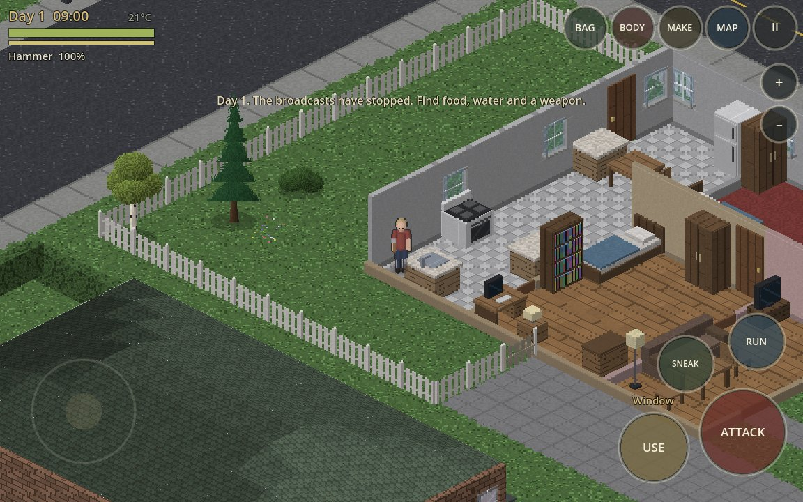
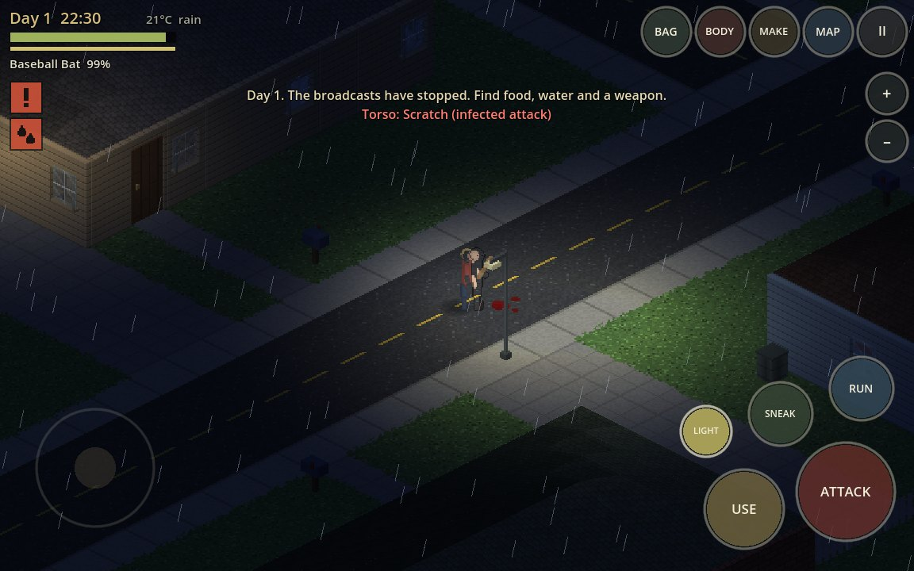

# LAST LIGHT

An original isometric zombie-survival game for Godot 4 (GL Compatibility), built for touch play on iPhone via Xogot with full keyboard parity on desktop.

**There are no image, audio or level files in this game.** Every tile, wall, roof, tree, piece of furniture, character animation frame, item icon and sound effect is generated by code when the game boots, and the world is generated from a seed as you walk.




## Run it

- **Xogot / Godot 4.3+**: open the project folder and press Play. The main scene is `res://main.tscn`.
- First launch paints ~2,000 sprites (about 3–5 s on a desktop CPU) behind a progress bar.
- Portrait and landscape both work; the HUD re-lays itself out.
- The earlier V3.6 single-house prototype is kept untouched at `res://legacy/house_v36.tscn`.

## Controls

| Action | Touch | Keyboard |
|---|---|---|
| Move | drag anywhere in the lower-left half (floating stick) | WASD / arrows |
| Run / Sneak | RUN / SNEAK toggles | Shift (hold) / C |
| Attack, shove, fire | ATTACK (hold to keep swinging) | Space |
| Interact | USE — tap; **hold** for all options | E — tap / hold, Q = options |
| Face / use something | tap it in the world | — |
| Zoom | pinch, or + / − | = / − |
| Inventory, Health, Craft, Map, Pause | BAG, BODY, MAKE, MAP, II | I, H, B, M, Esc |
| Flashlight / Reload | LIGHT / LOAD (appear when relevant) | F / R |
| Shove / Call out | SHOVE (with a weapon drawn) / CALL (whisper while sneaking, shout otherwise) | V / G |
| Draw a weapon | hotbar slots under the top buttons | 1–4 |
| Fast-forward | 1x / 2x / 4x button (drops to 1x when hunted) | T |
| Driving | stick steers and accelerates, big button = BRAKE, USE = EXIT | WASD, Space, E |

Each finger is tracked independently, so you can move, attack and interact at the same time.

## What is in the game

- **World** — unbounded, deterministic, chunk-streamed. Regions hold hamlets, towns and cities joined by highways; towns have street grids, zoned blocks, houses with generated floor plans and furniture, and 15 kinds of shops and civic buildings; the countryside has forests, lakes, farms with crop fields, cabins and camps.
- **Character** — 15 occupations, 39 traits on a points budget, appearance, four start locations, 21 skills.
- **Body and mind** — calories and body weight, exercise, boredom, misery, stress, drink, head colds.
- **Survival** — hunger, thirst, fatigue, stamina, panic, pain, body temperature, wetness, sickness; six body parts with scratches, lacerations, bites, deep wounds and fractures that bleed, get infected and need bandaging, disinfecting, stitching or splinting; the Grey Fever from bites.
- **The infected** — see (range depends on light, weather, sneaking and cover) and hear (footsteps, doors, glass, gunshots, alarms, each other); path around obstacles, batter down doors, windows, barricades and player-built walls, climb through broken windows, and wander in from outside your view in growing packs. Shamblers, fast ones, crawlers and brutes.
- **Combat** — melee with reach, swing time, knockback, knockdown, crits, stealth kills and weapon wear; shoving and stomping; firearms with magazines, spread, range and a very loud report.
- **Items** — 242 items, weight and carry capacity, bags, clothing that tears and can be patched, weapons that wear and can be repaired, perishable food, refrigeration while the power lasts, 52 loot tables.
- **Crafting and building** — 127 recipes in 8 groups: cooking, carpentry, weapons, tailoring, repair, workbench metal and electrical work; place walls, doors, fences, floors, crates, shelves, beds, rain collectors, compost bins; barricade; dismantle; fell trees.
- **Farming, foraging, fishing, trapping** — till, plant, water, fertilise, harvest, compost; set baited snares in open country.
- **Places and events** — cellars under houses, randomized scenes left by other survivors, an aircraft flyover that stirs up the dead, distant gunshots and alarms, alarms you can cut, streets that overgrow over the weeks.
- **Custom sandbox** — 15 world rules on the new-game screen, and guided first objectives.
- **The long game** — day/night, weather and seasons, the power grid and the water mains both fail some days in, generators, building alarms, 13 skills with XP and skill books, 9 starting occupations, permadeath.
- **Persistence** — autosave (every 2.5 min, on pause, and whenever the app is backgrounded); only chunks that differ from the generator are stored.

## Project layout

```
main.tscn / scripts/main.gd     entry point, boot, game loop
scripts/core/                   isometric projection, deterministic hashing
scripts/data/                   tiles, walls, objects, items, loot tables, recipes
scripts/art/                    software rasteriser + generators for all sprites
scripts/world/                  chunks, world generator, building generator, queries, A*
scripts/sim/                    player, zombies, interactions, crafting, clock/weather, saves
scripts/render/                 chunk strips, entities, lighting, weather, effects
scripts/ui/                     touch HUD and menus
scripts/audio/                  synthesised sound effects
tests/godot/  tools/godot/      automated tests and the test runner
docs/                           architecture, checkpoints, iPhone checklist
legacy/                         the earlier prototypes (not used by the game)
```

See [docs/MECHANICS.md](docs/MECHANICS.md) for every mechanic and the test that covers it, [docs/ARCHITECTURE.md](docs/ARCHITECTURE.md) for the engine design and save format, and [docs/checkpoints/](docs/checkpoints/) for what has and has not been verified.

## Tests

```
GODOT=/path/to/godot tools/godot/run_tests.sh            # headless
GODOT=/path/to/godot tools/godot/run_tests.sh --shots out # + rendered screenshots (needs xvfb-run)
```

Import/parse, world generation, a 71-check gameplay simulation, 68 checks of the character / event / crafting mechanics, 465 cross-system integration checks (vehicles, fire, survivors and settlements, your shelter, wildlife, crops, weather, power and water, the infected, documents, special sites, bridges, saves), 196 checks of the systems from the A–Z design archive (24 occupations and 16 temperaments, 18 vehicle types, 20 wild species, 24 crops, prisons, labs and bunkers, cold-slowed infected, animations, the sound mix, settlements moving, substation repair, cables and pumps, masks and generator fumes, hurt hands, asking for help, threats and apologies, grapples, fighting fire and smoke, reputation by witness and rumour, the journal, safe placement, the world-event director, new wildlife and gear, vibration, save export and import), a 43-check synthetic multi-touch test against the real scene, a boot test and a bot soak. Status per system: [docs/BIBLE_COVERAGE.md](docs/BIBLE_COVERAGE.md) (against the Gameplay & Mechanics Bible), [docs/COVERAGE_MATRIX.md](docs/COVERAGE_MATRIX.md) and [docs/RELEASE_READINESS.md](docs/RELEASE_READINESS.md). All pass on Godot 4.3 and 4.5. **None of this replaces playing it on the phone** — see [docs/checkpoints/IPHONE_CHECKLIST.md](docs/checkpoints/IPHONE_CHECKLIST.md).

## Originality

All code, art and audio in the game are original and generated procedurally. It contains no assets, names, maps or characters from any other game.
