# LAST LIGHT — Collected Asset Review Gallery V1

**Collected 2026-11-08 · isolated branch · no merge/deploy.**

This page is the **single visual index** to the original assets, texture output and review candidates already on this branch. It is not a claim that every image has passed the Golden visual or in-game integration gate. Follow the actual files, manifests and factories. The source repository remains authoritative.

## 1. Golden 40 — all forty review/reference sprites

The source manifest confirms **40 entries**, 20 items and 20 weapons, each saved at **64px, 128px and 256px** sizes (120 individual PNGs), plus the dark and light comparison sheets. The founder approved these as the **visual style benchmark**; manifest says inventory/reference icons only, not every item available as a world object.

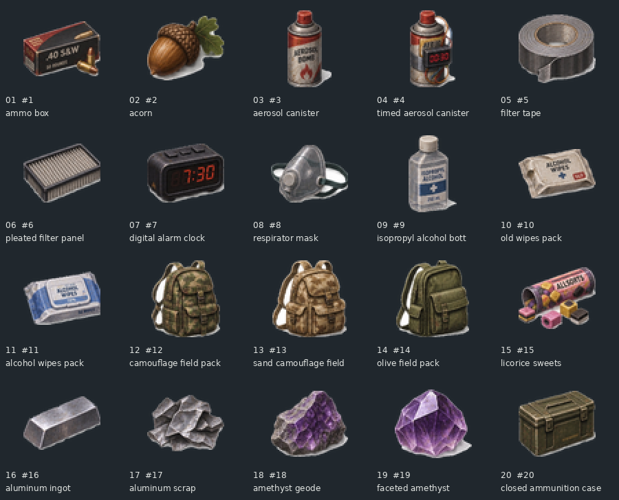
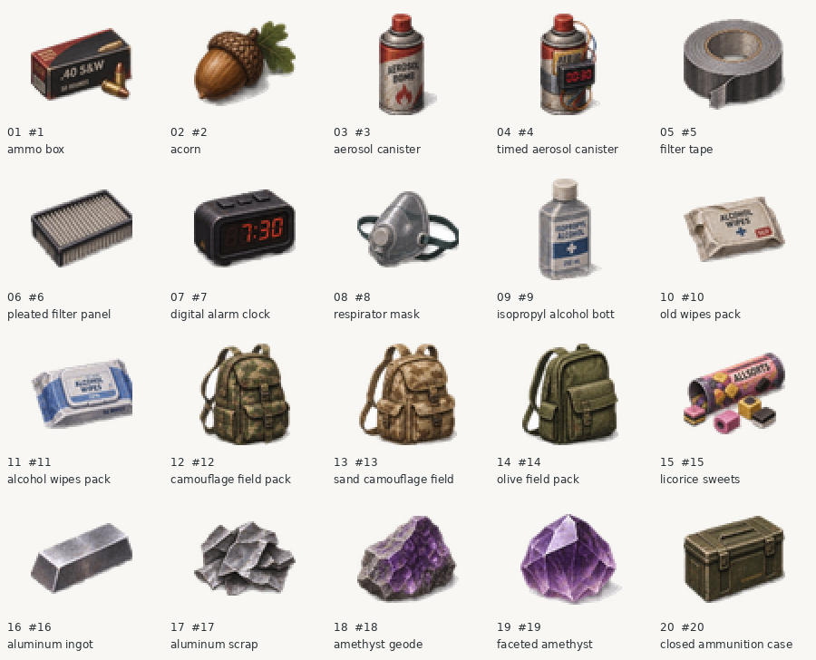

[Explore all Golden 40 PNG files](../assets/last_light/golden40) · [Golden 40 manifest](../assets/last_light/golden40/manifest.json)

## 2. Golden Vehicle hatchback V1 — real 16-direction Blender sprites

Original unbranded compact hatchback; one original 3D source and sixteen 22.5° viewing angles. Actual native transparent sprite images and material variants remain **technical candidates**. The car is not presently drivable.

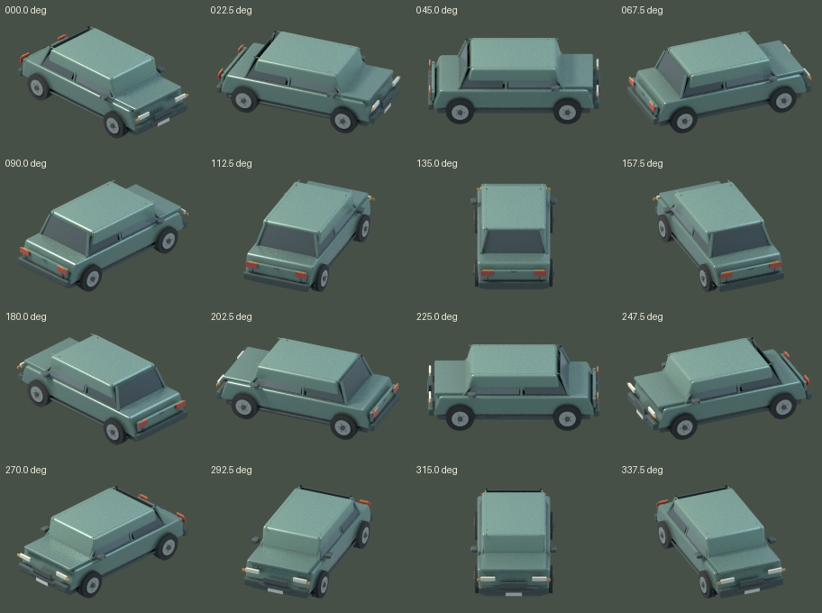

[Native vehicle atlas](../preview/vehicle-factory-v1/vehicle_16_headings.png) · [pixel-finished atlas](../preview/vehicle-factory-v1/vehicle_16_headings_pixel_refined.png) · [original vs pixel finish](../preview/vehicle-factory-v1/pixel_finish_comparison.png) · [16-angle visual turntable GIF](../preview/vehicle-factory-v1/vehicle_rotation_preview.gif) · [manifest](../preview/vehicle-factory-v1/manifest.json)

## 3. Additional vehicles — real Blender smoke prototypes

Two distinct original body types were generated: a sedan and an open-bed pickup (16 headings each), not just recolored hatchbacks. Their geometry remains **below Golden quality**, particularly the boxy sedan roofline.

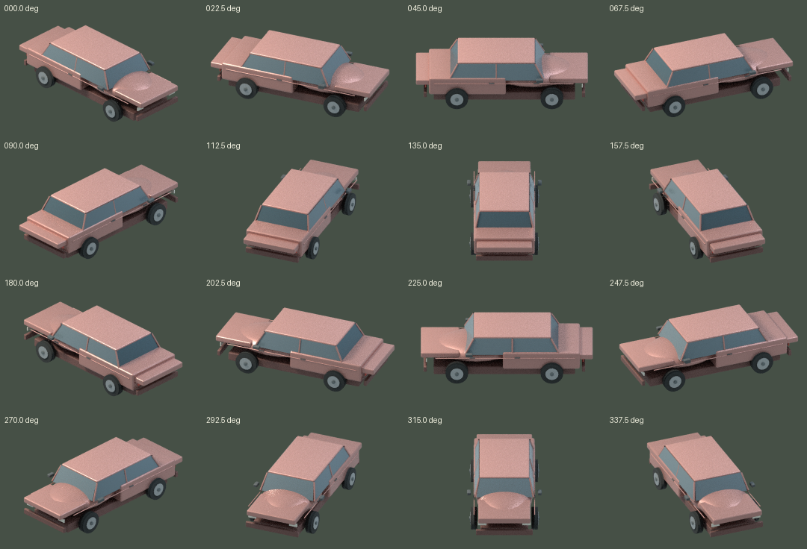
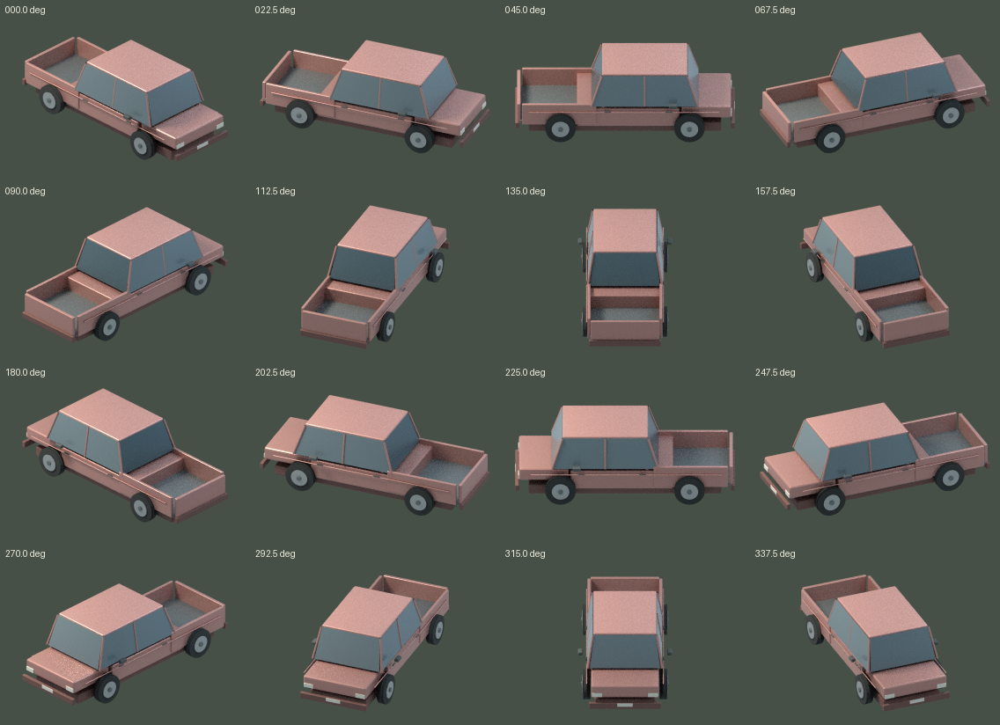

[Full fleet proof directory](../preview/fleet-factory-v1) · [fleet source scripts](../tools/vehicle_factory) · [batch report](../preview/fleet-factory-v1/batch_report.json)

## 4. Characters and zombies — original procedural Blender candidates

Five body/outfit variants, four facing directions. Human worker has a visible crowbar, with four-frame walk; medical zombie has a four-frame shamble. Original geometry is still too simple compared with the approved **actor concept**; layered cloth and persistence are not gameplay-integrated.

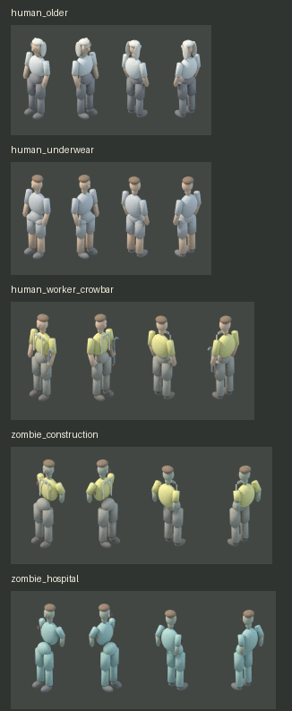

[All actor PNGs and atlases](../preview/actor-factory-v1) · [worker walking GIF](../preview/actor-factory-v1/human_worker_crowbar/walk_preview.gif) · [hospital zombie shambling GIF](../preview/actor-factory-v1/zombie_hospital/shamble_preview.gif) · [actor manifest](../preview/actor-factory-v1/manifest.json)

## 5. Hollow furniture animations — three real Blender sequences

These are the refrigerator main door, its freezer compartment door, and paired cabinet doors, each nine rendered frames and reverse-close support. Their shell cavities/shelves are structurally modeled, but actual inventory UI/slot transactions are not yet wired into the live game.

| Animated furniture | Visual preview |
| --- | --- |
| Refrigerator main door | 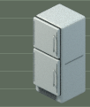 |
| Refrigerator freezer door | 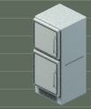 |
| Double-door cabinet | 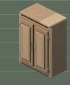 |

[Frames and strips](../preview/animation-factory-v1) · [animation manifest](../preview/animation-factory-v1/manifest.json) · [source rigs](../tools/animation_factory)

## 6. New furniture and upgraded material/texture tests

Furniture: refrigerator, cabinet and sofa, with experimental geometry/material improvement packages, before/after comparisons and native size reviews. This section stores **actual Blender/material candidates**; founder-approved refined image-generation **concepts** may be separately available in the conversation and should not be mistaken for the reproducible mesh source.

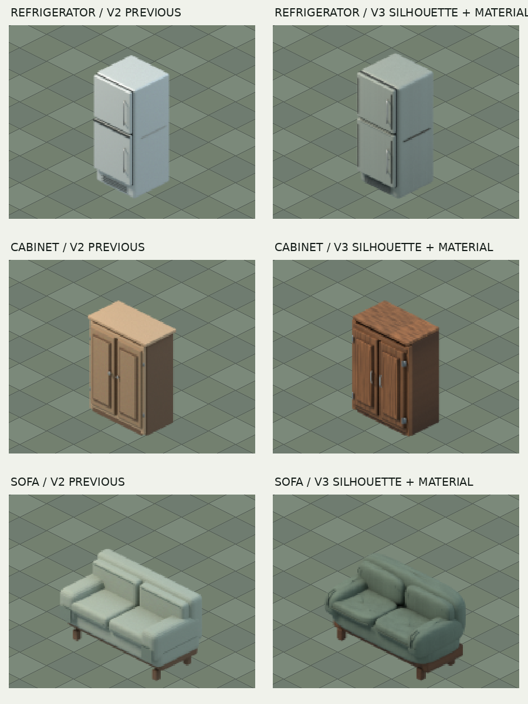
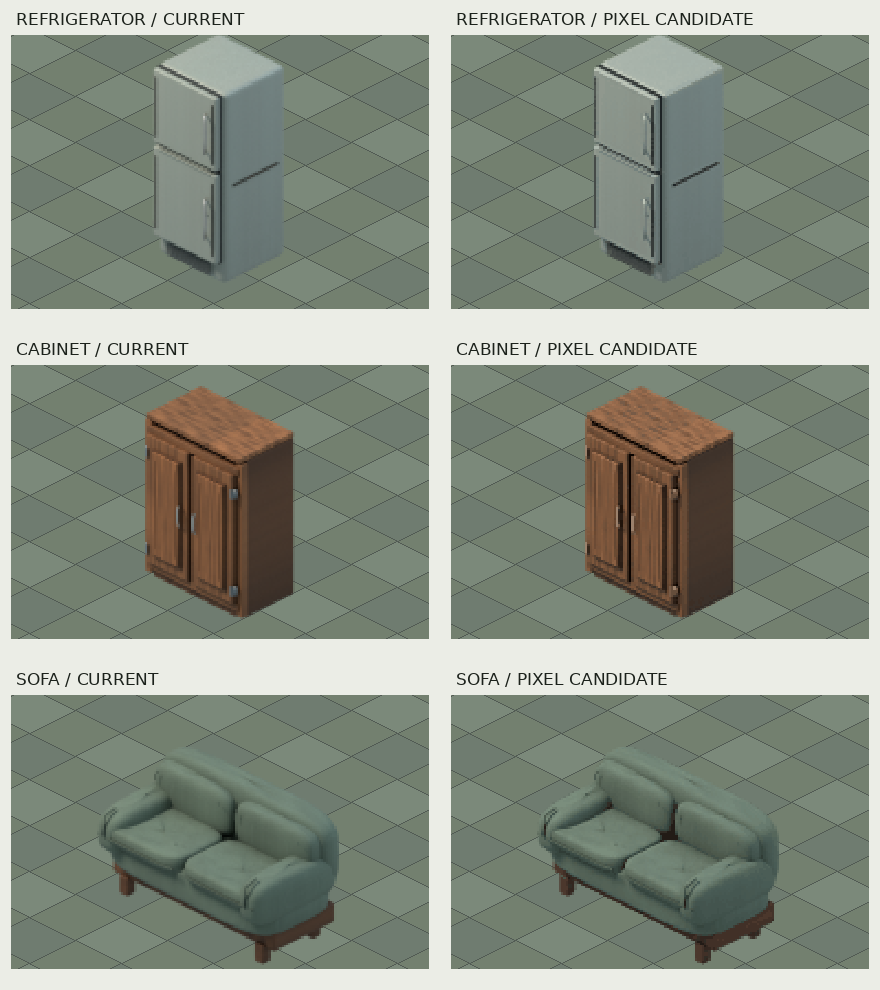
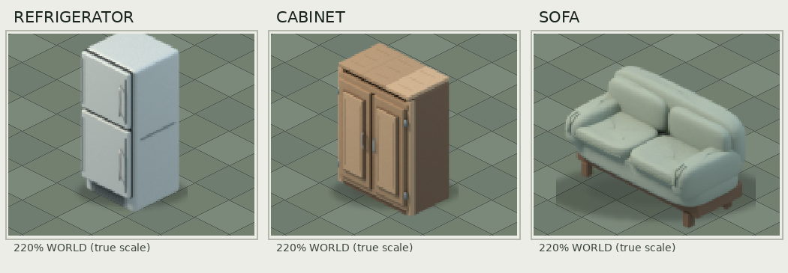

[Latest furniture package directory](../preview/material-factory-v2/hero-detail-test) · [older V3 geometry source ZIP](../preview/v3-recovery/last-light-v3-3-hero-preview.zip) · [source Blender factory](../tools/blender_factory)

## 7. Material library, textures and four wear conditions

The material pipeline includes **four condition levels**, original procedural material recipes, previews, manifests and texture refinement tools. Not every material has passed visual Golden approval.

| Condition | Sheet |
| --- | --- |
| 0 Maintained | 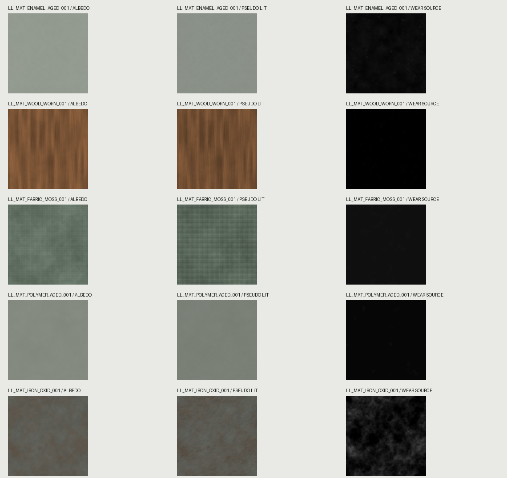 |
| 1 Used | 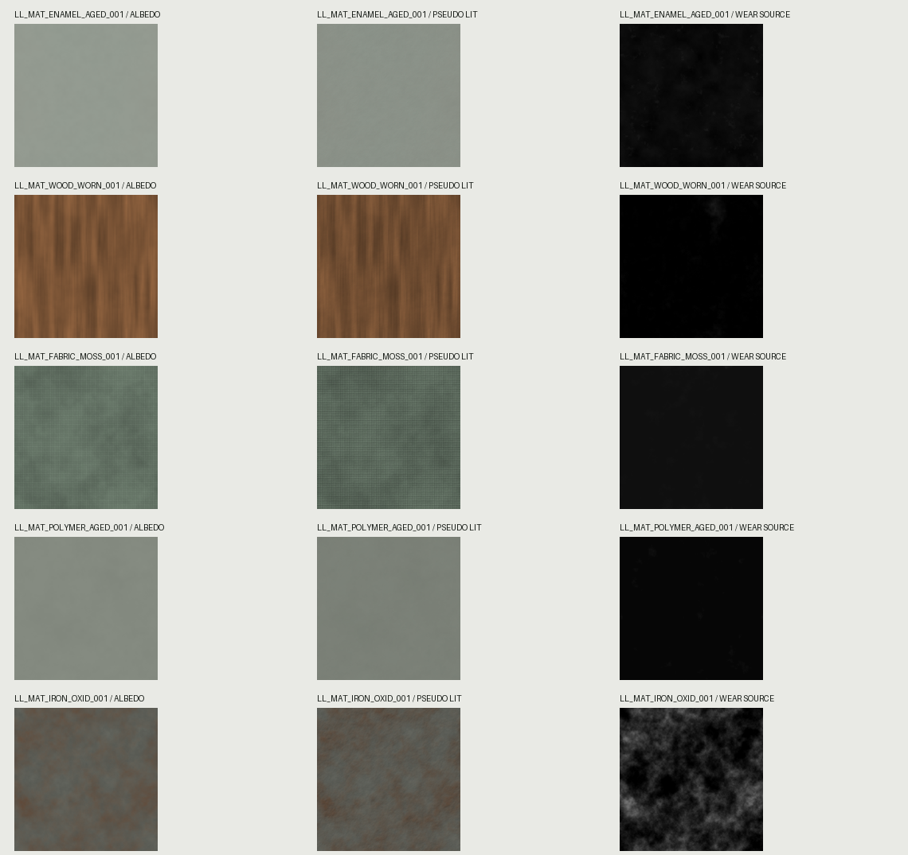 |
| 2 Weathered | 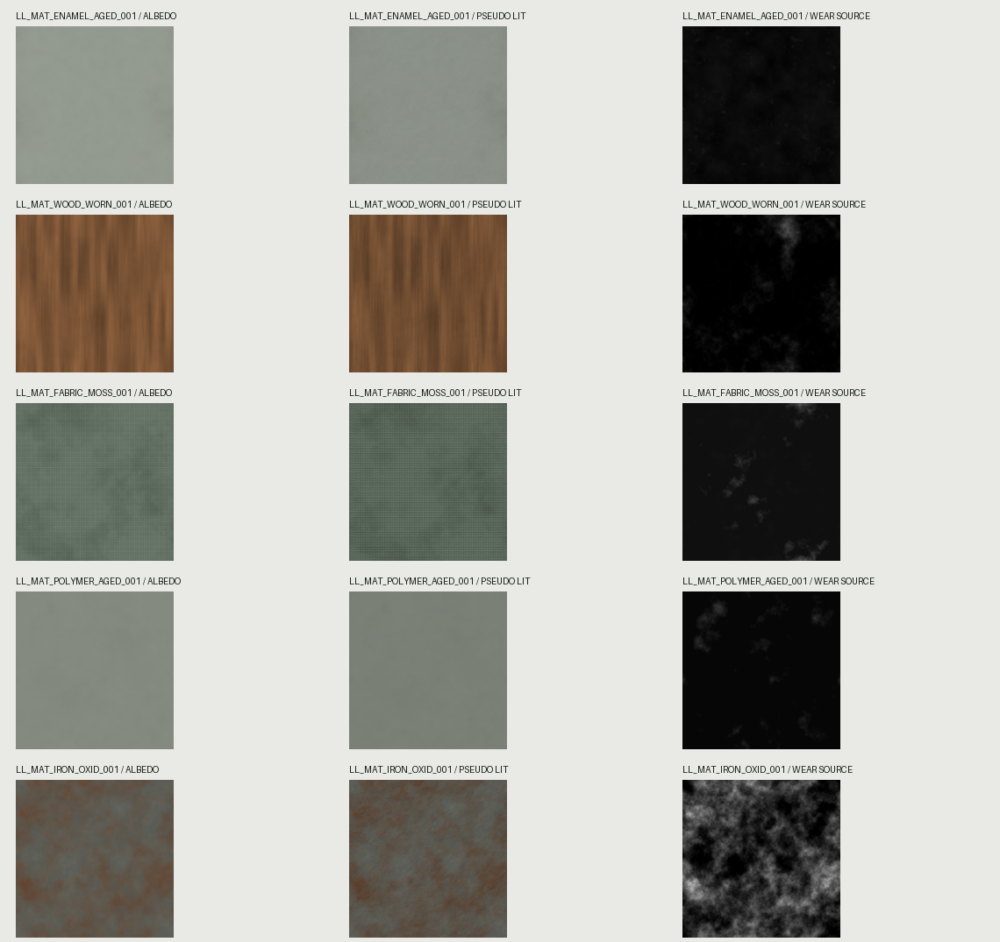 |
| 3 Severely neglected | 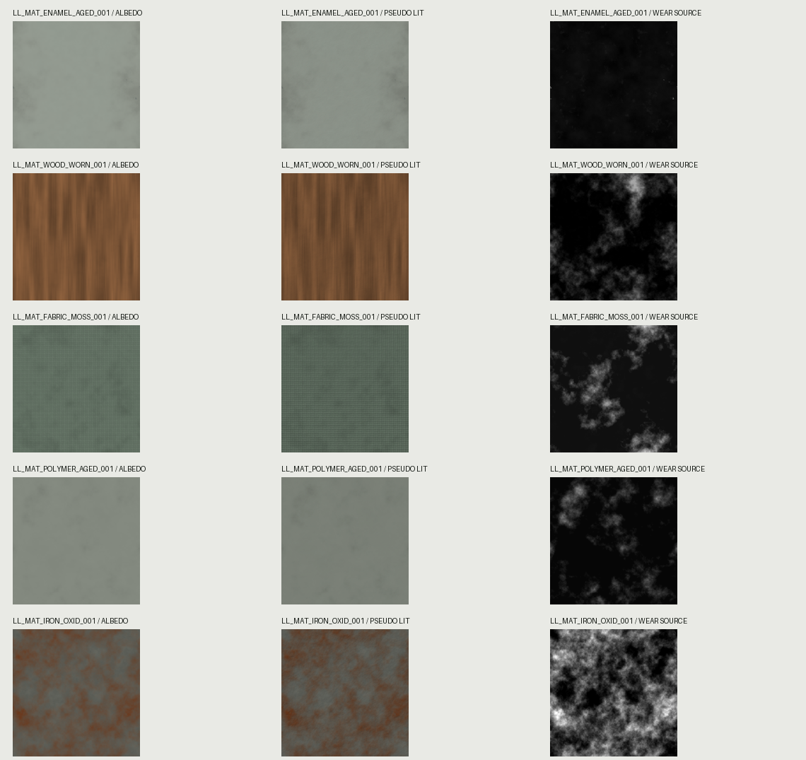 |

[Five-material factory and ZIP](../preview/material-factory-v1) · [material condition batch](../preview/material-factory-batch-v1) · [source material and pixel-refinement scripts](../tools/material_factory)

## 8. Recent small sprites + existing 300-item factory catalog

300 existing candidate item IDs (icons/ground/held views where defined) are present, and four specific original items were separately verified in a two-worker, parallel Blender proof. **The smaller items do not yet meet the Golden 40 quality standard.**

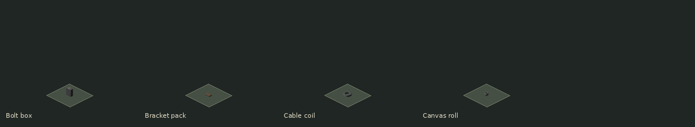
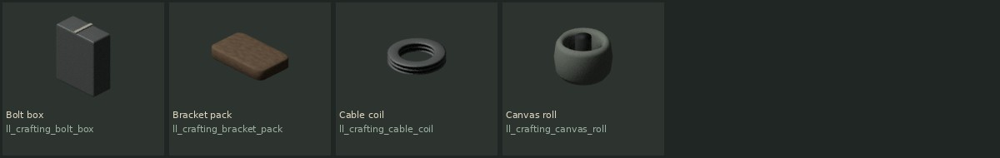

[300-item catalog and sprites](../assets/generated/factory) · [latest 4-item proof](../preview/parallel-factory-v1) · [Godot's 311 generated resource records](../assets/generated/master_import_v1)

## 9. Original factory scripts, rules and Codex mandate

[Master Asset Library](../assets/master_library) · [Headless original Blender asset factory](../tools/asset_factory) · [Materials/textures](../tools/material_factory) · [Actors/zombies](../tools/actor_factory) · [Animations](../tools/animation_factory) · [Vehicles](../tools/vehicle_factory) · [Unified Godot importer](../tools/unified_factory) · [Exhaustive asset census Codex mandate](./CODEX_COMPLETE_CENSUS_MASTER_FACTORY_V2.md)

---

### Packaging and release-state rules

The [Asset Review Bundle GitHub Actions workflow](../.github/workflows/last-light-asset-collection-v1.yml) exports the already authored asset directories into a downloadable archive. This is **collection, not new art generation**. It must not change the saved game, release new binaries, merge or deploy, or promote any candidate to final Golden art by accident.

Notion remains the production definition/approval center. GitHub is the versioned storage for images, manifests, source scripts and generated SpriteFrames.
