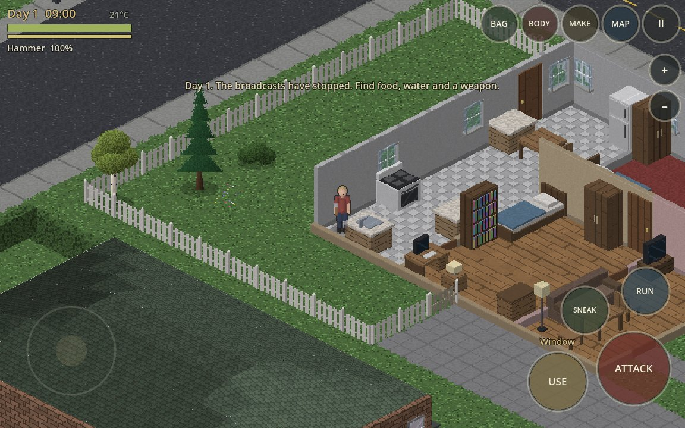
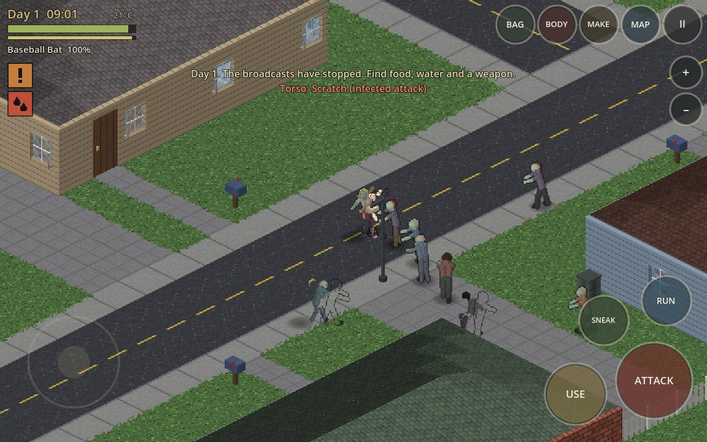
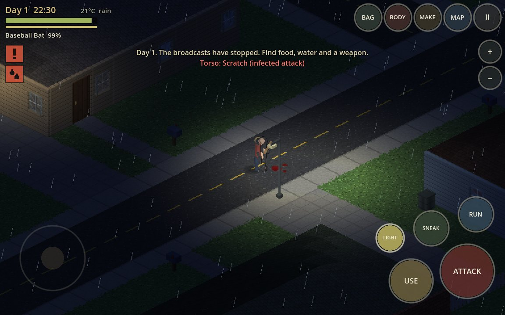
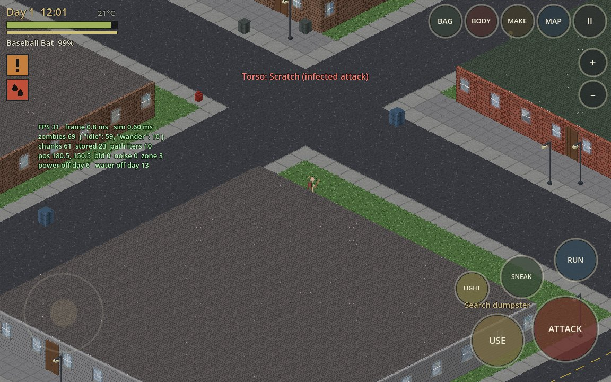
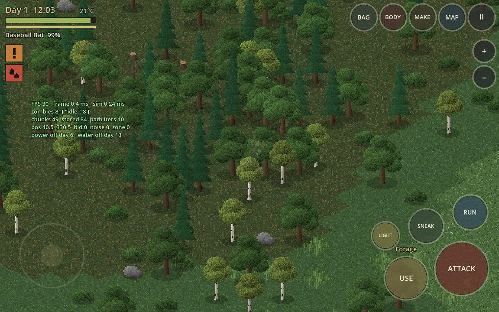
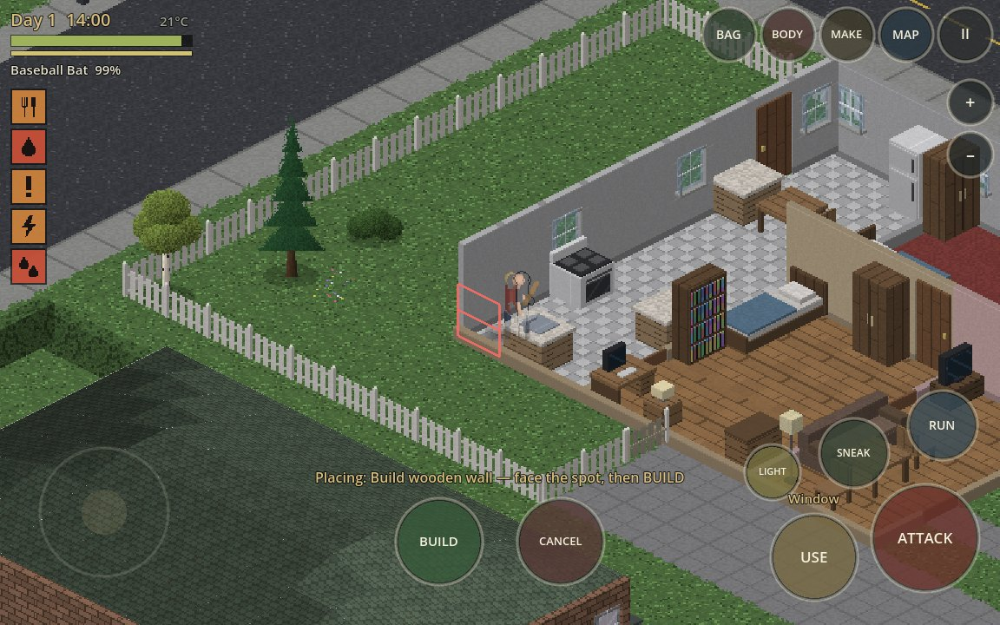
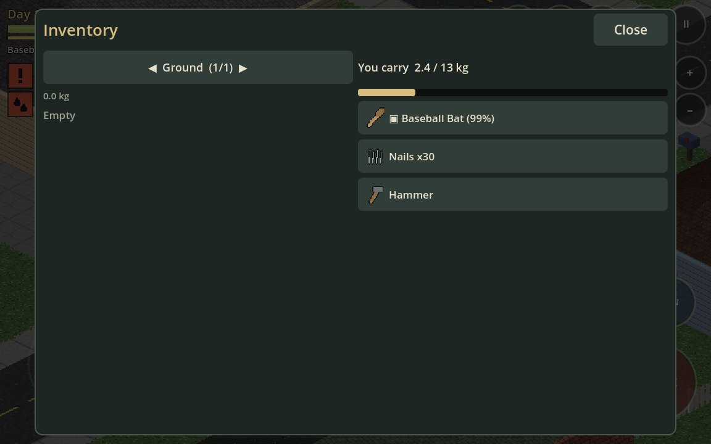
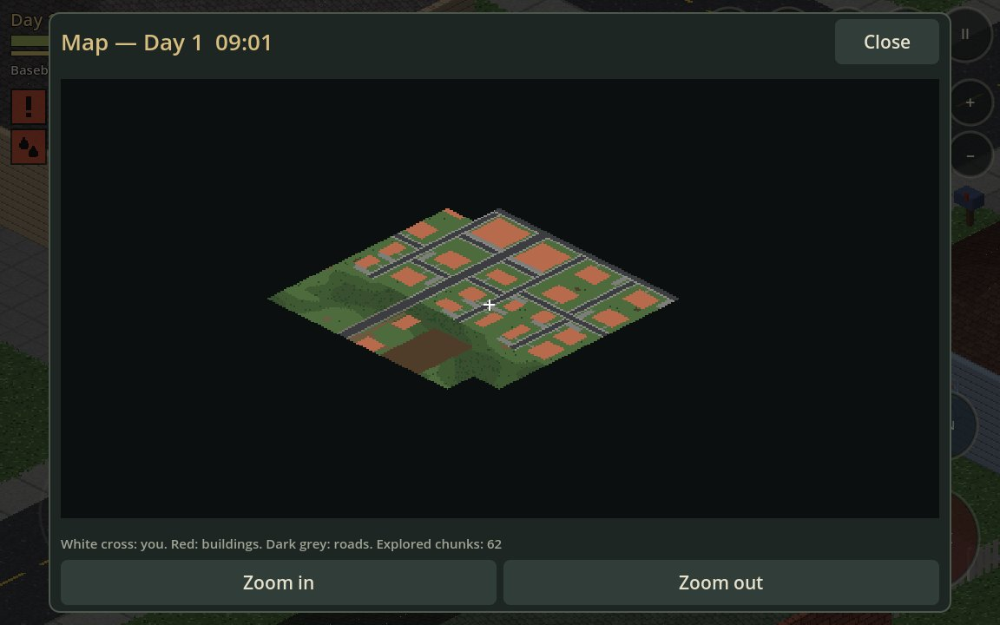
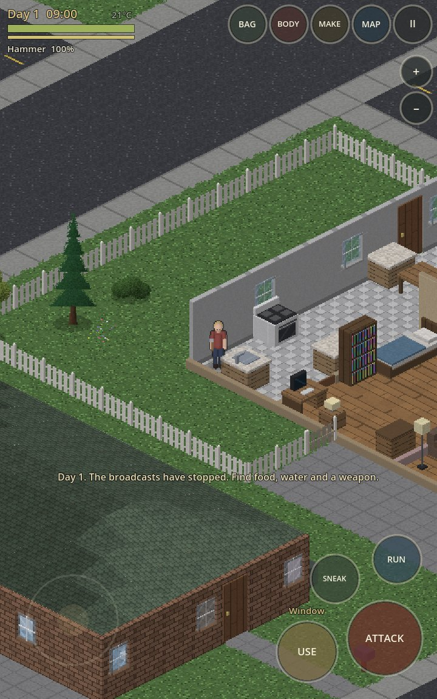
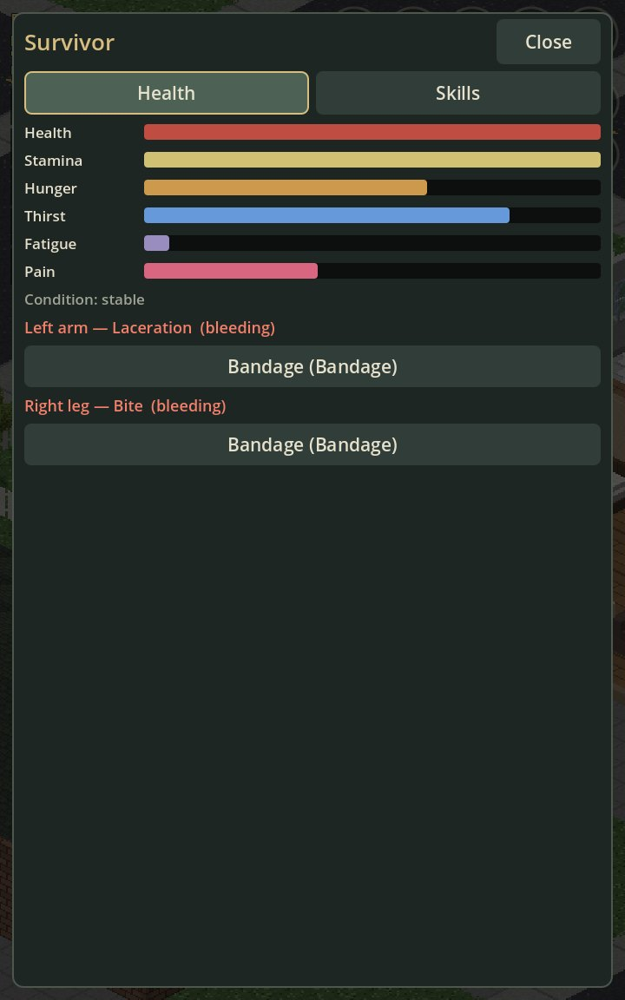

# Checkpoint — V0.4 → V0.8 (2026-11-12)

Branch: `claude/isometric-zombie-survival-fvuedo` · Entry scene: `res://main.tscn` (`scripts/main.gd`) · Engine: Godot 4.3 (also run on 4.5)

## Status in one paragraph

The game was rebuilt as a new engine on this branch: procedural art, an unbounded generated world, a full survival simulation, a touch HUD and menus, saves, and an automated test suite. All five milestones are **implemented and pass every automated check listed below, in a real Godot runtime**. **None of them is labelled complete**, because no part of this has been run on an iPhone or in Xogot, frame rate on a phone has not been measured, the generated audio has never been listened to, and nobody has yet played it by hand for balance. The manual list for that is [IPHONE_CHECKLIST.md](IPHONE_CHECKLIST.md).

One deliberate departure from `CODEX_V04_V08.md`: it lists "huge world" as *not in V0.8*. The request for this work explicitly asked for a huge seamless world, so V0.8 here is an unbounded streamed world rather than a three-house neighbourhood.

## Commits

| SHA | Contents |
|---|---|
| `ec729db` | Art pipeline, world generator, chunk store, item/loot/recipe data |
| `44211ed` | Simulation: player, zombies, interactions, crafting, farming, saves; gameplay test |
| `73338b7` | Renderer, HUD, menus, lighting, audio, main loop; touch test, screenshot runner |
| `10e63fd` | UI fixes, landscape layout, building pre-generation, 4.5 compatibility run |
| `5eb345b` | Panel sizing, soak test, CI workflow, documentation, screenshots |
| (this commit) | Finger-scrollable lists, roof batching (718 → ~260 draw calls downtown), first-minute hints |

Files: 43 new GDScript files under `scripts/` (~10,900 lines), 5 test scripts and the runner under `tests/godot/` and `tools/godot/` (~830 lines), `project.godot`, `main.tscn`, docs. The three earlier prototype scripts and two scenes moved to `legacy/` unchanged apart from their paths.

## Tests performed

Command (exact): `GODOT=/opt/godot/Godot_v4.3-stable_linux.x86_64 tools/godot/run_tests.sh --shots <out>`
Full output: [test_log_2026-11-12.txt](test_log_2026-11-12.txt)

| Step | What it does | Result |
|---|---|---|
| import | `--headless --import`: parses every script | ok, no errors |
| worldgen | generates the 576 chunks of the start region, checks determinism and the spawn | ok — 1.26 ms/chunk average, 87 ms worst |
| simulation | `tests/godot/test_sim.gd`: 71 checks across movement, collision, doors, barricades, melee, firearms, zombie sight/hearing/attack, wounds, food, loot, crafting, building, farming, pathfinding, power, save/load, chunk unload/reload, 3-minute AI soak | 71 / 71 pass |
| touch | `tests/godot/test_touch.gd`: synthetic `InputEventScreenTouch/Drag` against the real main scene — joystick, attack with a second finger while moving, release, toggles, USE tap and hold, panel button, pause-while-open, pinch, finger-scrolling a list | 19 / 19 pass |
| boot main | runs `main.tscn` for 400 frames | ok |
| soak (bot) | real main scene, a bot moves, fights, interacts, opens every panel, sleeps, saves, teleports 160 tiles; 4,500 frames | ok, no script errors; 0.74 ms/frame headless |
| render portrait / landscape | real OpenGL (Mesa llvmpipe under Xvfb), 20 screenshots each including save → title → continue and the death screen | ok |

The same suite (without rendering) was run on **Godot 4.5-stable**: all pass (71/71, 19/19, boot, soak).

What these tests do **not** show: real touch hardware behaviour, safe-area values on a real device, GPU performance, thermal behaviour, audio quality, whether the game is fun or fair.

## Screenshots

Captured from the running game by `tests/godot/shot_runner.gd` (not mock-ups):

| | |
|---|---|
|  Home interior with roof and front walls cut away |  Street fight |
|  Night, rain, flashlight |  Downtown with the performance overlay |
|  Forest |  Build placement |
|  Inventory |  Map |
|  Portrait |  Health panel |

## By milestone

### V0.4 — Essential playable loop
Implemented: boot without parser errors; floating joystick with per-finger capture, independent ATTACK / USE, release clears input, keyboard parity; isometric movement with collision against edge walls and furniture; doors (open, close, lock, break); roof and wall cutaway; infected that chase and attack with a cooldown; looting; death and restart; pause; autosave and Continue.
Evidence: touch test 19/19; sim test "movement & collision", "doors", "combat", "save / load"; screenshots 01, 02, 09.
Acceptance ("move in all directions while pressing attack; enter/exit house and toggle doors; zombie combat; no soft lock"): passes in the synthetic touch test. **Unverified on the phone.**

### V0.5 — Detailed visual world
Implemented: one tile specification (2:1, 64×32); reusable sprite compositor with diagonal depth sorting; textured floors, walls, roofs, windows, door frames and ~55 furniture/prop models; 8-direction walk, idle, attack, shove, aim, hit, fall and death animations for survivor and infected; blood, debris and muzzle effects; rain, fog, day/night; atlases with trimmed sprites; provenance in `ASSETS.md`.
Evidence: rendered screenshots; `tools/godot/art_dump.gd` writes the atlases for inspection.
Acceptance: indoor/outdoor layering and cutaway look correct in every captured view. **"Usable responsiveness on iPhone" is unmeasured.** Art is procedural placeholder-grade by design and is marked as such.

### V0.6 — Survival and loot
Implemented: tap-friendly inventory with stacks, containers, weight and encumbrance, bags and clothing; 45 loot tables; food, drink, medicine, weapons; hunger, thirst, fatigue, stamina and more; item use; everything saved.
Evidence: sim test "needs & food", "wounds & medicine", "looting", "save / load".
Migration from V0.4: the V3.6 prototype wrote no save file, so there is nothing to migrate; the save schema is versioned from here (see `docs/ARCHITECTURE.md`).

### V0.7 — Zombies, stealth and combat
Implemented: state machine with idle, wander, investigate, chase, attack, thump, stagger, down and climb; sight affected by light, weather, sneaking and cover; hearing of graded noises; A* navigation that routes through breakable barriers; melee reach and arcs, durability, knockback, knockdown, wounds; noisy firearms; caps on active infected and path requests; in-game overlay with counts, frame time and AI states.
Evidence: sim test "combat", "firearms", "pathfinding", soak (0.54 ms/tick with 111 infected); screenshot 04 shows the overlay.

### V0.8 — Explore a (very large) world
Implemented: unbounded seamless world streamed in chunks; towns with dozens of enterable, furnished, lootable houses and shops; roads, yards, fences, trees, parked cars; reusable building generator and lot data; visibility culling by strip; day/night and weather; an explored-area map; persistence of every change.
Evidence: worldgen test; sim test "changes survive chunk unload / reload"; bot soak teleport; screenshots 04, 05, 07.
Acceptance ("loot homes, return to the first, close/reopen doors, restart and load matching progress"): the save/load and unload/reload checks cover the state side. **A human walk-through has not been done.**

## Changed UX (compared with the V3.6 prototype)

- The default scene is a different game: title screen, survivor creation, an open world instead of one house.
- Orientation is no longer locked to portrait; both orientations are supported and the HUD rearranges.
- The joystick is floating (appears where the thumb lands) rather than fixed.
- USE replaces INTERACT; holding it lists every action. GOD mode moved to **II → Tester mode**.
- The old prototype is still runnable from `legacy/house_v36.tscn`.

## Unresolved issues and known gaps

- Not run on iPhone or Xogot. Frame rate, loading time and touch feel on device are unknown. ~260 draw calls downtown is comfortable for a modern iPhone on paper but unproven.
- Audio is synthesised and has only been checked for errors, not for how it sounds.
- Balance (hunger rates, damage, loot density, infected numbers) is a first guess with no hand play-testing.
- Art is functional procedural art: flat-shaded boxes, simple figures. No ground-tile blending beyond ragged edges, no animated water, no multi-storey buildings.
- Corner posts at building corners that fall on a chunk border can be missing a pixel column.
- Occasional short streets end blind inside a block (generator artefact, cosmetic).
- One save slot. No settings screen after game start beyond the pause-menu toggles.
- Not built: driving, NPC survivors, multiplayer, basements/upper floors, traits, a tutorial beyond the How to Play page.
- A GitHub Actions workflow for the test suite is included (`.github/workflows/godot-tests.yml`) but has not run yet; it triggers on pull requests.

## Next prerequisites

1. Run `IPHONE_CHECKLIST.md` in Xogot and report failures, the loading time and the FPS figure.
2. Decide from that whether the next step is performance work (fewer strips / larger batches), control tuning, or content and balance.
3. Nothing has been merged to `main` and nothing has been deployed.
