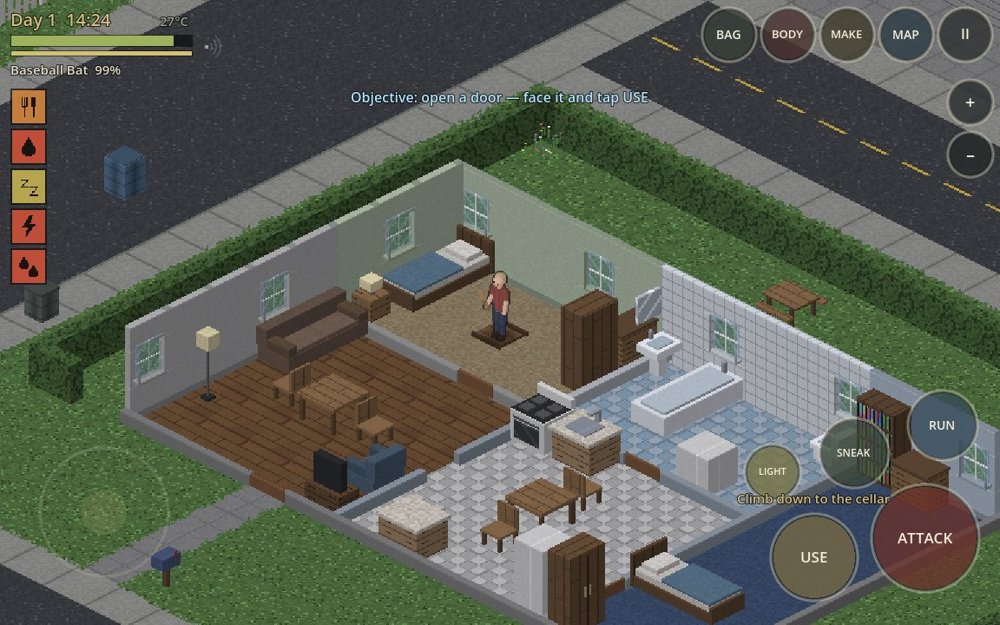
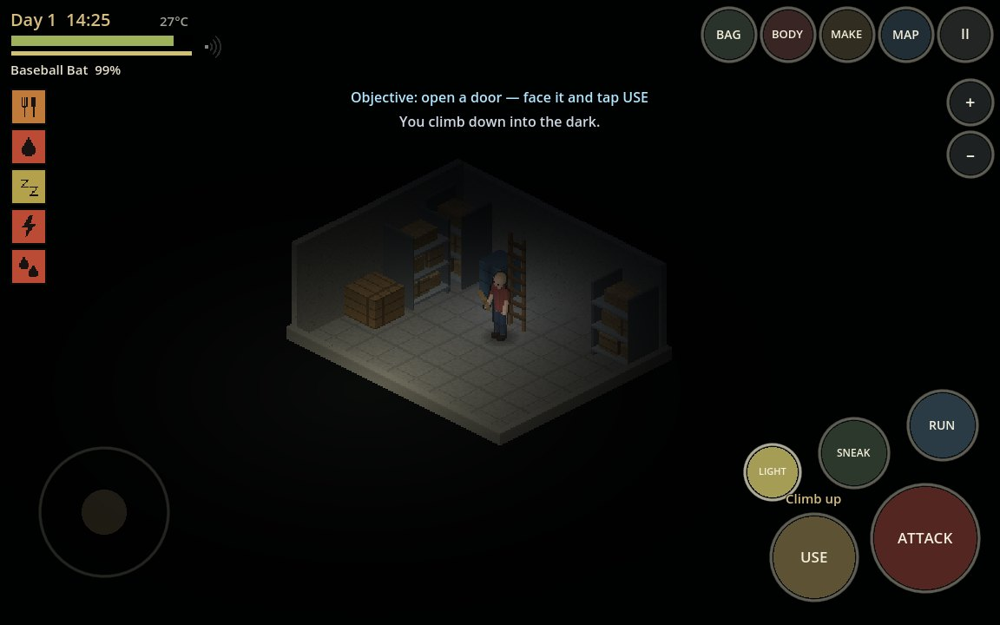
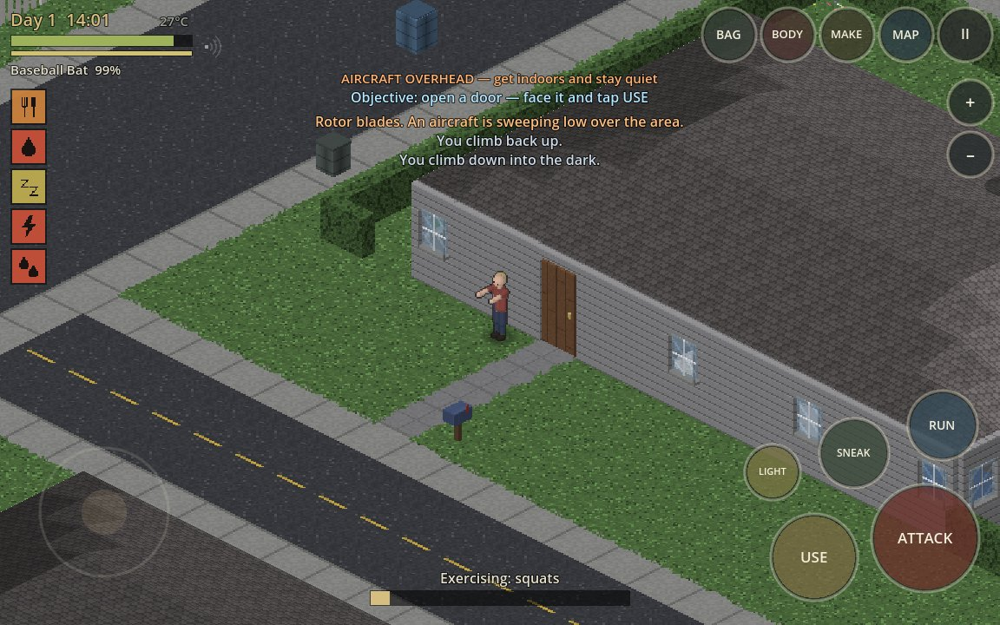
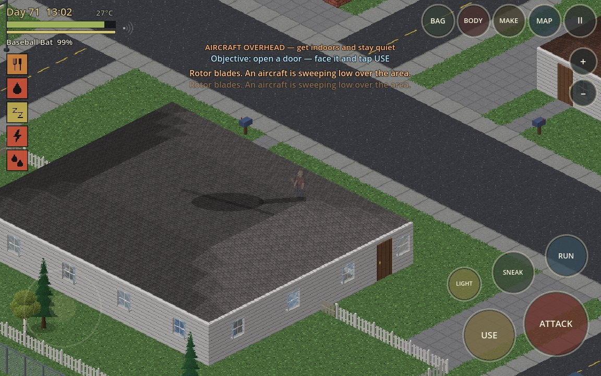
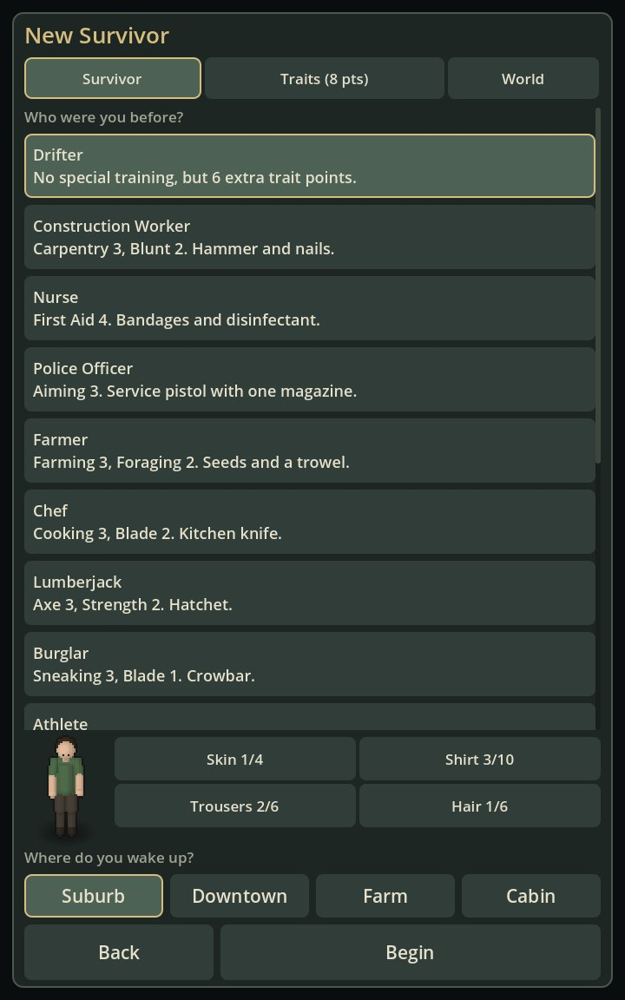
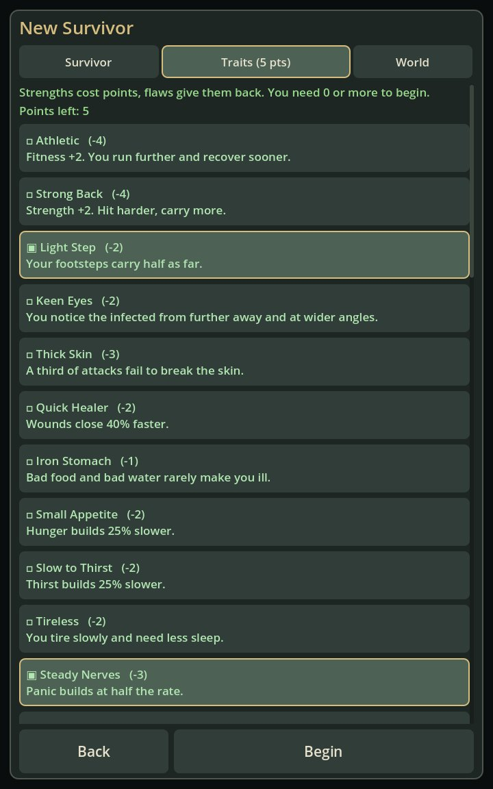
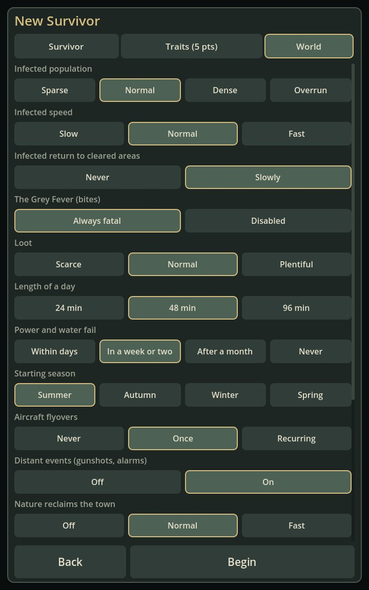
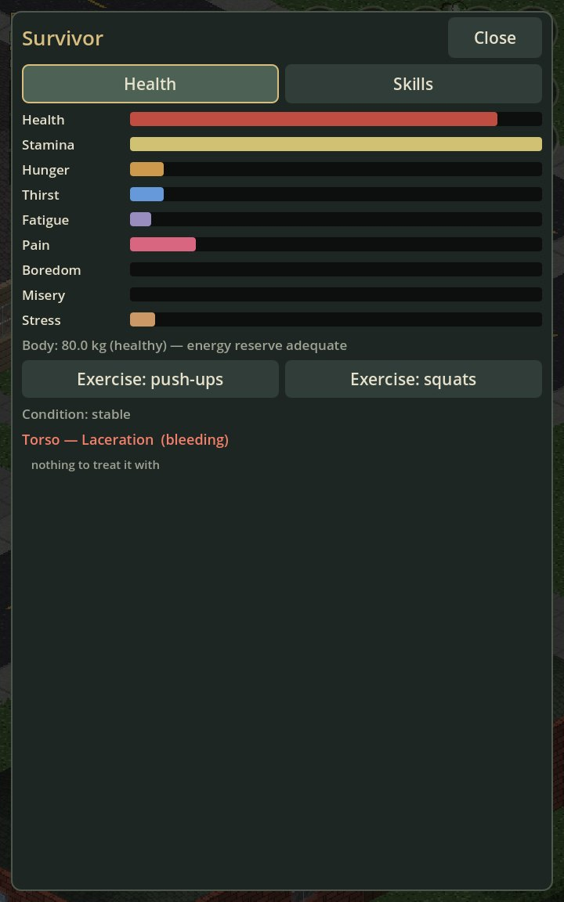

# Checkpoint — mechanics pass (2026-11-12, second)

Branch: `claude/isometric-zombie-survival-fvuedo` · Entry scene: `res://main.tscn` · Engine: Godot 4.3 (also run on 4.5)

Request: add the mechanics listed in the wiki's "Game mechanics" category, with all assets and animations generated in code. Coverage, topic by topic, is in [../MECHANICS.md](../MECHANICS.md).

## Honest status

- Implemented and passing automated checks in a real Godot runtime: every topic in the table in MECHANICS.md.
- **Still not run on an iPhone or in Xogot.** Not labelled complete. The earlier device checklist still applies; nothing here changes that.
- The wiki page could not be opened (the site blocks automated clients). The topic list came from a search snapshot of the category and its Character sub-category. To attempt the fetch I moved this session onto the repository's saved `last-light-godot` cloud environment and added `pzwiki.net` to its allowed hosts; the site then answered with a bot challenge, which I did not try to get around. That host entry is still on the environment and can be removed.
- No text, items, names, maps or art were taken from that game or its wiki.
- Not built: driving, upper floors, NPCs, multiplayer, fire spread.
- Balance of all the new numbers (calories, trait costs, trap rates, flyover length) is a first guess.

## Commits

| SHA | Contents |
|---|---|
| `d867415` | Traits, occupations, nutrition, exercise, mood, new skills, condition and repair, workshop, traps, compost, salvage, cellars, stories, flyover, distant events, overgrowth, sandbox, objectives, new art and sounds, save schema 3, mechanics test |
| (this commit) | Radio broadcasts, appearance editor with live preview, documentation, screenshots |

Files changed: 26 scripts under `scripts/` (now ~12,300 lines, 1 new: `data/traits.gd`), `tests/godot/test_mechanics.gd` (new), `tests/godot/shot_runner.gd`, `tools/godot/run_tests.sh`, docs.

## Tests performed

`GODOT=/opt/godot/Godot_v4.3-stable_linux.x86_64 tools/godot/run_tests.sh --shots <out>` — full output in [test_log_2026-11-12b.txt](test_log_2026-11-12b.txt)

| Step | Result |
|---|---|
| import | ok |
| worldgen (determinism, 221+ buildings escapable and fully reachable — now including hatches, barricades and story props) | ok |
| simulation | 71 / 71 |
| **mechanics** (new) | 68 / 68 |
| touch | 19 / 19 |
| boot main | ok |
| soak (bot, 4,500 frames) | ok, no script errors |
| render portrait / landscape (26 screenshots each, incl. cellar round trip, flyover, ten-week overgrowth) | ok — downtown ~275 draw calls, 26 MB textures |

Same headless suite on Godot 4.5-stable: all pass.

## Screenshots (captured from the running game)

| | |
|---|---|
|  A hatch in the floor |  The cellar below, by flashlight |
|  Aircraft shadow on the roof; squats |  The same town in week ten |
|  Occupation, appearance, start |  Traits |
|  Sandbox |  Body, mood, exercise |

## Changed UX

- New-game screen has three tabs: Survivor, Traits, World.
- BODY shows boredom, misery, stress, weight and energy reserve, and has exercise buttons.
- MAKE has three more groups (Tailoring, Repair, Workshop); the tab row wraps.
- A blue objective line sits under the top bar until the eight first steps are done (or is off if disabled).
- A small noise meter sits next to the health bar.
- Saves from before this pass load (schema 2 → 3) without traits, flyovers or objectives.

## Unresolved

- Everything in the first checkpoint's list still stands.
- The flyover and distant events have audio that nobody has listened to.
- Story houses can occasionally be the nearest building to a new survivor's home; the start house itself is never one.
- Overgrowth only appears on chunks the player has not altered, so a street you built on stays tidy.

## Next prerequisites

Play it on the phone. `docs/checkpoints/IPHONE_CHECKLIST.md` first, then a free session with the performance overlay on.
