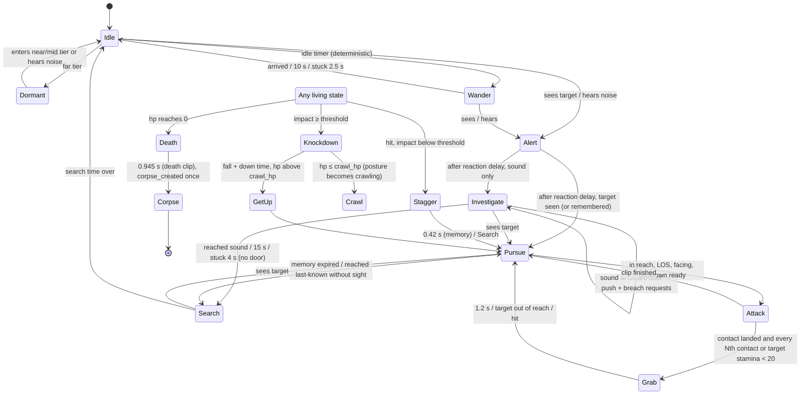

# LAST LIGHT — Zombie AI (Worker 03)

Branch `claude/worker-03-zombie-ai-h6ty9i`, based on PR #10 head `codex/house-survival-v05-v06` @ `86bff44`.
Entry scene unchanged: `res://main.tscn`. Engine: Godot 4.6.3-stable (official Linux build, headless + Xvfb/llvmpipe).

## Status (evidence-based)

| Capability | Status | Evidence |
|---|---|---|
| State machine (15 states) | GODOT_TESTED, GAME_INTEGRATED | `tests/zombie/zombie_ai.gd` T01–T13 |
| Sight: range, FOV, occlusion, exposure, last-known | GODOT_TESTED, GAME_INTEGRATED | T01, T03, T04, T05 |
| Hearing: event noises, attenuation, wall/door occlusion | GODOT_TESTED, GAME_INTEGRATED | T01, T02, T07 |
| Navigation: cached A*, direct steering, stuck recovery, separation | GODOT_TESTED, GAME_INTEGRATED | T06, T16, house_survival |
| Door breach requests | GODOT_TESTED, GAME_INTEGRATED | T07, house_survival |
| Attack contact timing, grab, stagger, knockdown, get-up, crawl | GODOT_TESTED, GAME_INTEGRATED | T08–T10 |
| Death → exactly one corpse, loot exactly once | GODOT_TESTED, GAME_INTEGRATED | T11, T12 |
| Save/reload (`zombie_ai` block) | GODOT_TESTED, GAME_INTEGRATED | T11–T13, full suite |
| Profiles + deterministic spawns | GODOT_TESTED (house uses 2 fixed spawns) | T14 |
| Tiered scheduling / budget | GODOT_TESTED (lab population on house lot) | T15, perf |
| Zombie art | PROCEDURAL_PLACEHOLDER only. Not GOLDEN_ART_APPROVED | screenshots |
| iPhone / Xogot | **UNVERIFIED** | — |

## Architecture

```
scripts/zombie/
  zombie_profiles.gd   data: 9 profile IDs, one shared parameter schema
  zombie_spawner.gd    deterministic spawn (FNV-1a of seed/region/building/room/index) → id, profile, loadout
  zombie_animation.gd  state→clip map, frame timing, contact events, footprints, sockets, 8 directions
  zombie_navigator.gd  per-agent cached paths on the host AStarGrid2D (same 0.4 m grid, same world metres)
  zombie_director.gd   FSM, perception, hearing, attacks, reactions, scheduling, persistence, stats
  zombie_renderer.gd   procedural placeholder poses driven only by anim_frame()
```

The director never touches player health, door health or the inventory. It emits events; the host applies them:

```
house.gd ──set_target/sync_bodies/emit_noise/notify_hit──▶ ZombieDirector.update(dt)
house.gd ◀── attack_contact · grab_start/end · door_breach · death · corpse_created · loot_transferred · state_changed
```

`house.gd` keeps `infected` / `zombie_health` / `zombies_hit_time` arrays as the shared body record (combat and the
existing regression tests write them). The director adopts external position/health edits each tick (`sync_bodies`)
and writes positions back (`write_bodies`).

### Host world interface (`zw_*`, implemented in `house.gd`)

`zw_blocked`, `zw_blocked_static`, `zw_try_move`, `zw_sight_blocked` (walls + closed doors; low furniture does not
block sight), `zw_sound_occlusion` (×0.45 per wall, ×0.6 per closed door), `zw_closed_door_near`, `zw_door_center`,
`zw_nav_grid`, `zw_nav_step`. A new map (Worker 04) only has to implement these.

## State diagram



`Crawl` is the pursuit locomotion state of a crawling posture; crawling zombies also use Idle/Investigate/Search/Attack
with crawl clips and crawl speed.

## State table

| State | Entry | Exit | Movement | Clip | Events | Interrupts | Timers | Saved as |
|---|---|---|---|---|---|---|---|---|
| dormant | far tier while idle/wander | near/mid tier, noise | none | idle | — | noise | far tick 1 s | idle |
| idle | spawn, search end, wander end | sight, noise, idle timer | none; 90° look-around | idle / crawl_idle | — | hit, noise | idle 3–6 s, look 2.4 s | idle |
| wander | idle timer (standing, `wanders`) | arrive, 10 s, stuck | walk 0.34 m/s within 3 m of home | shamble | — | sight, noise, hit | — | idle |
| alert | sight/noise from idle/wander | reaction delay (0.22 s; halved within 1.2 m) | turns toward stimulus | investigate | — | hit | reaction | investigate |
| investigate | sound after alert | sees, reached, 15 s | 0.55 m/s to sound | shamble | door_breach + door_bang noise when blocked at door | sight, louder noise, hit | 15 s | investigate |
| pursue | seen/remembered target | in reach, memory 5 s, lost | 0.78 m/s (fast 1.15) to live target / last known (+≤1 m extrapolation) | shamble / fast_shamble | door_breach when blocked | hit, death | memory 5 s | pursue |
| search | lost target, investigate end | sees, 6 s | visits ≤3 deterministic points within 2 m | shamble / investigate | — | sight, noise, hit | 6 s | search |
| attack | reach .62 m, LOS, facing dot > .7, cooldown | clip end (0.57 s) | turns at half rate before contact | attack / crawl_attack | **attack_contact once at frame 3 (0.285 s)** if still in reach×1.2, LOS, in front | hit → stagger cancels contact | cooldown 0.8 s | pursue |
| grab | contact landed + grab rule | 1.2 s, out of reach ×1.6, hit | holds | grab | grab_start / grab_end (host slows player ×0.35) | shove/hit | 1.2 s | pursue |
| stagger | hit below threshold, any hit while crawling | 0.42 s | none (host knock-back) | stagger | — | hit (re-enters) | clip | pursue |
| knockdown | impact ≥ threshold (or hit while down) | fall 0.77 s + down 1.6 s | none | knockdown → down | — | hit (restart), death | clip + down | knockdown |
| getup | knockdown end, hp > crawl_hp | 0.9 s | none | get_up | — | hit → knockdown | clip | knockdown |
| crawl | knockdown with hp ≤ crawl_hp, crawler profile | as pursue | 0.26 m/s | crawl | as pursue | as pursue | memory | crawl |
| death | hp 0 (any state) | 0.945 s | none | death (never replays) | death once | none | clip | corpse |
| corpse | death clip end | never | none | corpse | corpse_created once; loot_transferred once | none | — | corpse |

Determinism: no `randf()`. Wander points, idle durations, look turns and search points come from FNV-1a hashes of the
agent seed and counters. Sight checks run on a time accumulator (0.2 s ±10 % per agent), so the 30/60/120 fps parity test
still holds.

## Perception and noise

| Parameter | Shambler | Notes |
|---|---|---|
| sight range | 6.8 m | ×0.55 sneaking, ×1.15 sprinting, ×0.85 standing still, ×0.75 crawling |
| field of view | 120° | inside 1.2 m: 360° awareness, line of sight still required |
| hearing | radius × profile hearing × occlusion | |

Host noises (`house.gd`): footstep every 0.6 m — sneak 1.0 m, walk 3.5 m, sprint 7.5 m; melee swing 3.5 m / hit 5 m;
shove 3 m; door open/close 6 m. Zombie door banging: 7 m once per second while breaching.

## Combat contract (Worker 02)

* `attack_contact {zombie, attack_id, damage, kind}` — `damage` is a request (12 claw, 8 crawler bite). Final damage is
  applied in `house.gd::_apply_zombie_attack` (Worker 02 contract point; `god_mode` respected).
* One contact per `attack_id`. A hit before frame 3 cancels the contact.
* Player hits call `zombies.notify_hit(i, "melee"|"shove", source, damage, hp_after)`. Player damage numbers stay in
  `_attack()` (Worker 02).

## Door contract (Worker 05)

`door_breach {zombie, door, amount}` per tick while a moving zombie is blocked within 0.55 m of a closed door. Amount =
`breach_rate × dt` (12/s shambler). The host applies it in `_apply_door_breach` (opens at 0, unchanged 45 HP doors).

## Profiles

`shambler`, `fast_shambler`, `injured` (2 HP, crawls at 1 HP after knockdown), `crawler`, `stagger_prone`,
`civilian`, `medical_orderly`, `security_guard`, `worker`. All share one parameter schema; `max_health` ≤ 3 keeps the
existing schema-2 `enemies[].health` bounds. House spawns: `civilian` (west yard) and `shambler` (east yard), world
seed 1107. Spawn contexts: residential, hospital, workshop, shop, road. Loot uses real item IDs from
`data/survival_items.json`; clothing IDs are gameplay tags only.

## Save schema (additive, file version stays 2)

`"zombie_ai": {"version": 1, "profiles_version": 1, "agents": [{id, spawn_key, context, profile, state, posture,
facing[2], home[2], last_known[2], memory, wander_count, hits_landed, attack_id, loadout{clothing[], inventory{}},
corpse_created, looted}]}`

* Position and health stay in `enemies[]` (unchanged). Agents align with `enemies` by index; count must match.
* Rejected (whole save, same as other corruption): duplicate IDs, unknown profile/state, corpse state with health > 0,
  looted without corpse, unknown item IDs, non-integer counts.
* Older saves without `zombie_ai`: living bodies start idle; dead bodies become corpses marked looted (no loot
  duplication from old data). Older builds ignore the extra key.
* Transient paths, perception caches and timers are rebuilt on load.

## Animation contract (Worker 07)

| Clip | Frames | ms | Loop | Footprint | Events |
|---|---|---|---|---|---|
| idle | 4 | 220 | yes | standing | — |
| shamble | 8 | 155 | yes | standing | footstep 1, 5 |
| fast_shamble | 8 | 90 | yes | standing | footstep 1, 5 |
| investigate | 6 | 180 | yes | standing | — |
| attack | 6 | 95 | no | standing | **contact 3** |
| grab | 6 | 200 | no | standing | grab_hold 1 |
| stagger | 4 | 105 | no | standing | — |
| knockdown | 7 | 110 | no | fallen | ground_impact 5 |
| down | 1 | — | yes | fallen | — |
| get_up | 6 | 150 | no | fallen | — |
| crawl | 8 | 190 | yes | crawling | — |
| crawl_idle | 2 | 400 | yes | crawling | — |
| crawl_attack | 6 | 110 | no | crawling | **contact 3** |
| death | 7 | 135 | no | fallen | corpse 6 |
| corpse | 1 | — | yes | fallen | — |

Directions: 8, screen-space (`Anim.direction_index`), matching the 2:1 projection in `house.gd::_iso`.
Required sockets: `ground_feet` (= world position in every clip; no per-clip root offset), `attack_contact`,
`vision_eye`, `sound_origin`, `held_loot_socket`. Footprints: standing r .17 m; crawling r .17, length .9; fallen
r .17, length 1.6.

### Missing animation / asset dependencies

All 15 clips above are **missing as production art**. The actor-factory branch
(`codex/last-light-actor-zombie-factory-v1-20261107`) contains preview-only 4-direction idle/shamble frames for
`zombie_construction` and `zombie_hospital`; they are not approved, cover 4 of 8 directions and 2 of 15 clips, and are not on
this branch. Missing: all 8-direction frames for every clip; corpse frame; clothing variants for the 15 clothing tags;
socket metadata; attack hitbox frames.

## Tests (executed)

```
GODOT_BIN=/path/to/godot bash tests/run.sh
```

Last run (exit 0): FOUNDATION 0 failures · GALLERY PASS · PLAYER MECHANICS 0 failures · SURVIVAL_MODEL 89/0 ·
HOUSE_SURVIVAL 156 checks/0 failures · CONTROL SETTINGS PASS · LOOT LOOP PASS · MIGRATION EDGES PASS ·
SAVE ISOLATION PASS · **ZOMBIE_AI 123 checks/0 failures** · ZOMBIE_PERF PASS.

`tests/house_survival.gd` change: the old breach fixture expected a zombie to find a silent, motionless player through a
closed door. That is now intentionally impossible. The fixture now closes the door with `_toggle_door` (a noise) and a
new negative check proves the silent case does not breach. 154 → 156 checks.

Screenshots (Xvfb + llvmpipe, 1152×720 desktop emulation): `docs/zombie/screenshots/`, produced by
`xvfb-run -a godot --path . --rendering-driver opengl3 --script tests/zombie/capture_zombie_states.gd -- --output-dir=…`.

## Measured performance (host, not iPhone)

`tests/zombie/zombie_perf.gd`: `ZombieDirector.update()` wall time, 600 ticks at 60 Hz, player walking a 7 m loop
around the house lot, all doors open. Host: 4-core Intel Xeon @ 2.30 GHz, Godot 4.6.3 official build
(`OS.is_debug_build()` = true).

| zombies | mean µs | p95 µs | max µs | full updates/tick | sight checks/tick | A* paths/s |
|---|---|---|---|---|---|---|
| 2 | 52 | 89 | 247 | 1.7 | 0.2 | 0.0 |
| 10 | 206 | 364 | 591 | 7.3 | 0.8 | 0.0 |
| 25 | 483 | 963 | 1594 | 17.2 | 2.0 | 0.8 |
| 50 | 978 | 2057 | 3749 | 32.0 | 4.0 | 1.2 |
| 100 | 1436 | 2892 | 14395* | 32.0 | 7.9 | 2.9 |
| 200 | 1740 | 5407 | 7981 | 32.0 | 15.5 | 8.1 |

\* single outlier tick. Full `main.tscn` `_process` with the default 2 zombies (no drawing): median 21 µs, p95 60 µs.
Remaining per-zombie cost is dominated by the shared collision queries (`_blocked`, linear over walls/furniture/doors).
Nothing here says how fast this runs on an iPhone. Do not claim large populations until Worker 08 measures on device.

## Handoff to Worker 01 (integration)

* Merge order: this branch sits on PR #10 (`codex/house-survival-v05-v06`). A trial merge with
  `codex/last-light-actor-zombie-factory-v1-20261107` @ `b725329` merges `house.gd`/`house_art.gd` automatically;
  the only conflict is `tests/run.sh` (both branches append suites; keep both). Not compiled/tested as a merged tree.
* Shared files edited: `scripts/house.gd` (integration hooks, `zw_*` interface, corpse interact target, `zombie_ai` save
  key), `scripts/house_art.gd` (zombie draw command: corpses visible, delegates to `_draw_zombie`), `tests/house_survival.gd`
  (breach fixture), `tests/run.sh` (two new suites).
* Entry points: `ZombieDirector.setup/spawn/update/set_target/sync_bodies/write_bodies/emit_noise/notify_hit/
  drain_events/take_corpse_loot/snapshot/validate_snapshot/restore/restore_legacy/anim_frame`, `stats`.

## Known limitations and next repair tasks

1. P1 — Host collision cost: `_blocked` is linear; a broadphase (Worker 04/01) would cut per-zombie cost most.
2. P1 — Real iPhone/Xogot run: AI timing, touch while grabbed, readability of placeholder states.
3. P2 — Zombies do not collide with the player body (unchanged from PR #10); the player can walk through them.
4. P2 — Mid-tier zombies move in 0.2 s steps; fine for the current 24 m lot, needs review on larger maps.
5. P2 — Sound occlusion counts wall crossings on a straight line (no propagation through open doorways around corners).
6. P3 — Grab only slows movement; Worker 02 to decide escape mechanics and damage over time.
7. P3 — Window/vault, multi-floor and lighting-based sight are not implemented.
8. Art — every clip is a procedural placeholder (see missing dependencies).
